<div align="center">


# AstroTales

**The machines NASA left on the Moon and Mars tell their own stories.**<br>
An interactive storytelling website for kids 8–12.

[](https://astro-tales-nasa.vercel.app)

[](https://www.spaceappschallenge.org/2026/challenges/nasas-discarded-equipment-storytelling/) [](LICENSE)   

<a href="https://astro-tales-nasa.vercel.app">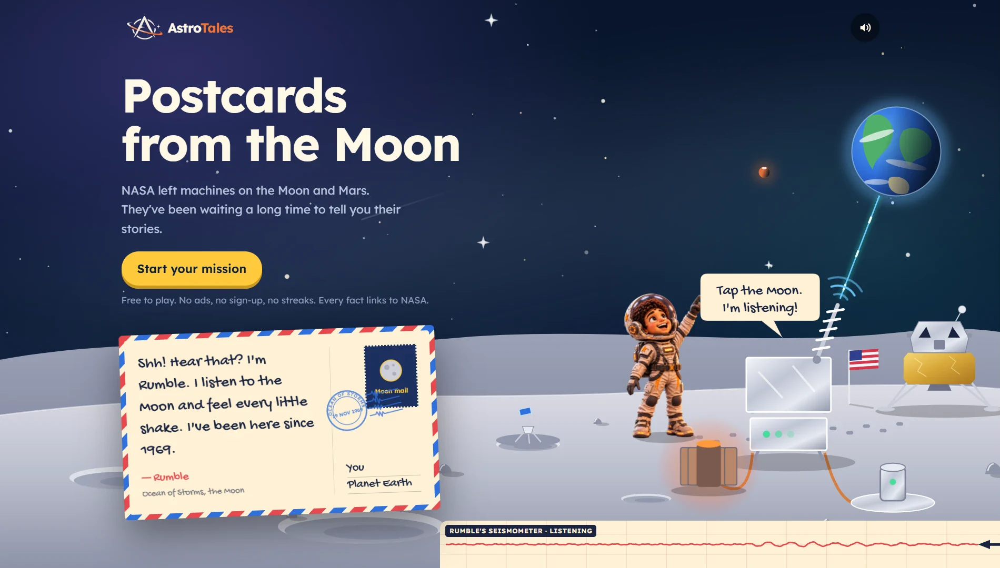</a>

</div>

## The idea

Kids 8–12 are used to short, swipeable content. Instead of fighting the scroll, AstroTales gives it a destination: every swipe is a real story from a machine NASA left behind, told in first person by the machine itself.

The kid **is the astronaut**. They launch from Earth, fly across a real solar system, land on the Moon or Mars, and meet each device where it really sits. The device tells its story with voice and subtitles, the kid checks what they learned with a **Fact or Cap?** quiz, and earns a collectible card. Every fact links to its NASA or NSSDCA source.

Built by **Team AstroPy** for the NASA Space Apps Challenge 2026 (Cairo), challenge: [Abandoned but not Forgotten](https://www.spaceappschallenge.org/2026/challenges/nasas-discarded-equipment-storytelling/).

## A quick tour

<table>
  <tr>
    <td width="50%">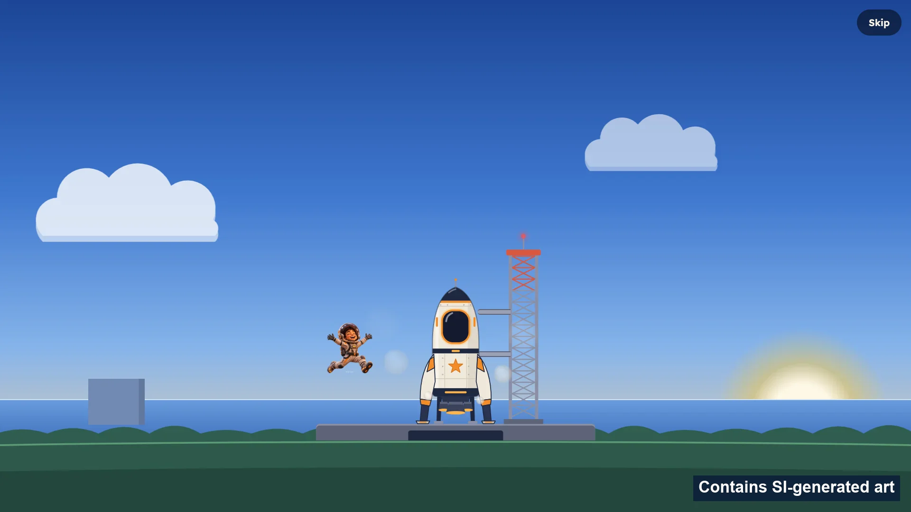<br><b>1. Launch</b> from Earth</td>
    <td width="50%">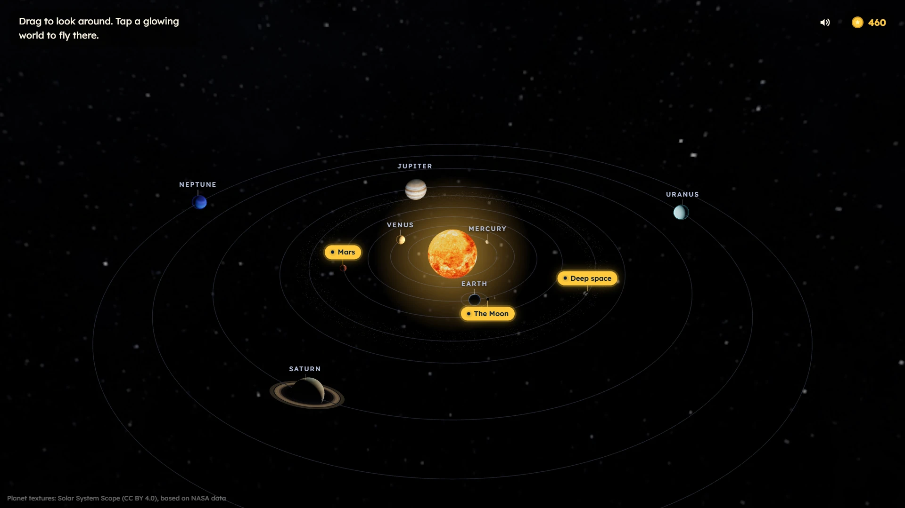<br><b>2. Pick a world</b> in a 3D solar system</td>
  </tr>
  <tr>
    <td>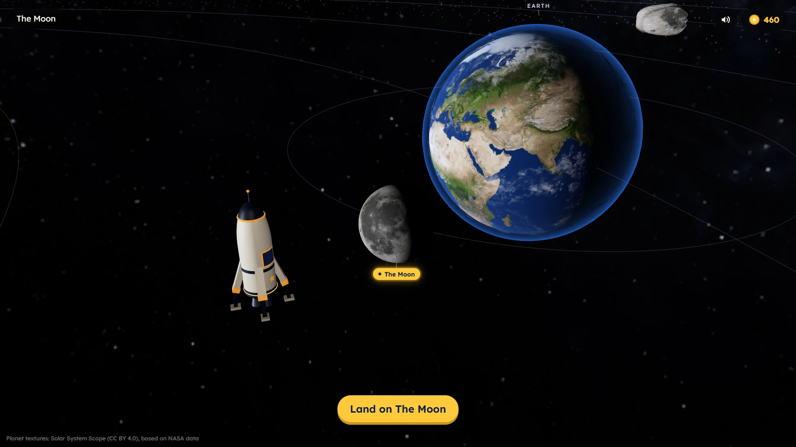<br><b>3. Fly</b> to the Moon</td>
    <td>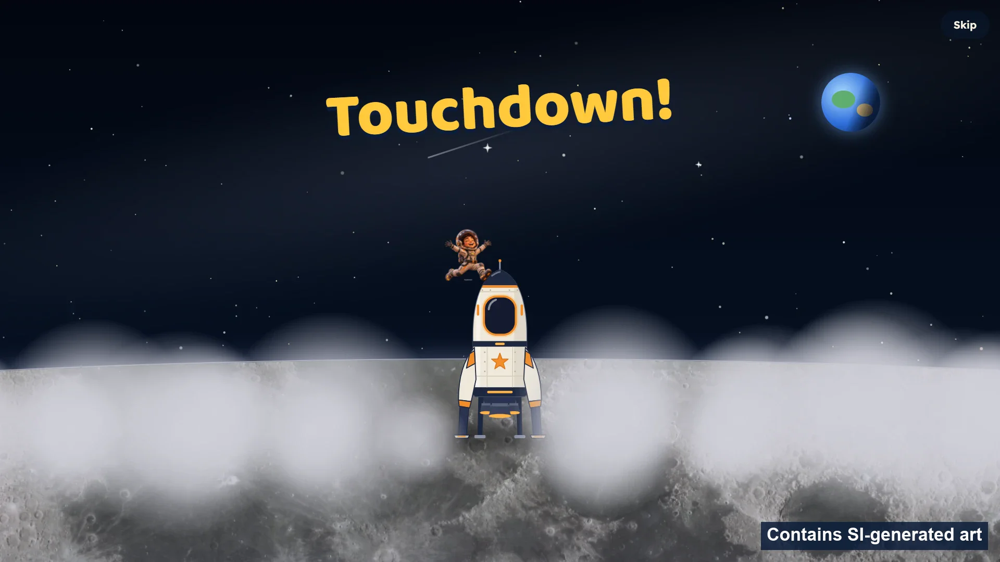<br><b>4. Touchdown!</b></td>
  </tr>
  <tr>
    <td>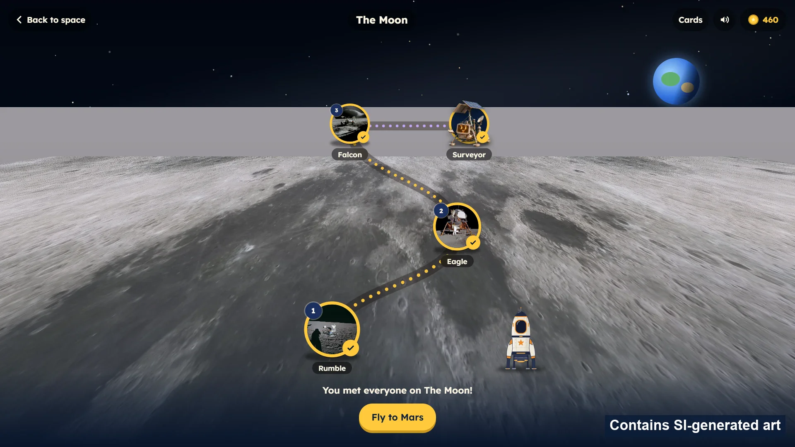<br><b>5. The map:</b> every device is a level</td>
    <td>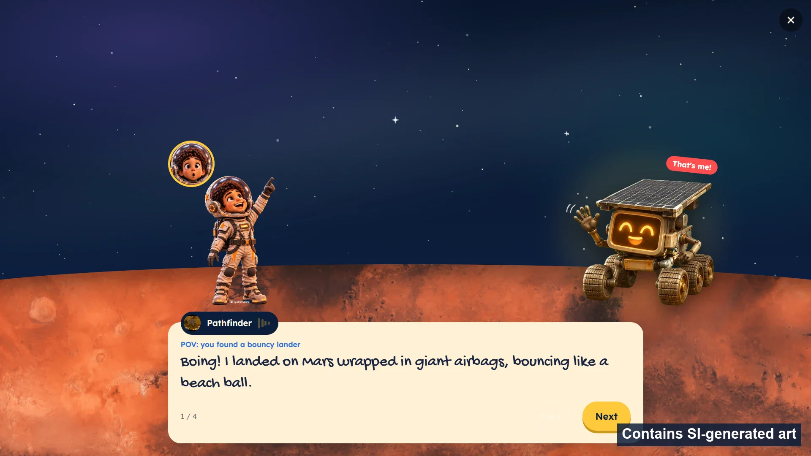<br><b>6. The device tells its story</b></td>
  </tr>
  <tr>
    <td>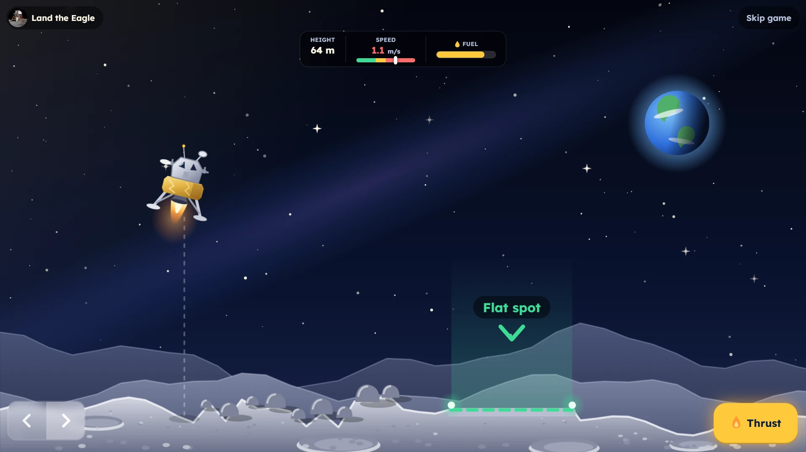<br><b>7. Mini-game:</b> land the Eagle</td>
    <td>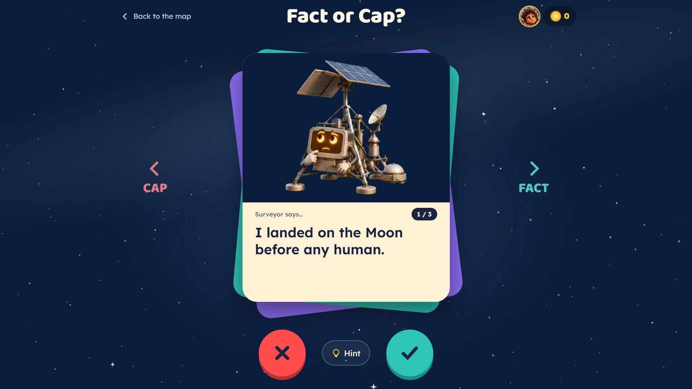<br><b>8. Fact or Cap?</b> Swipe or tap to answer</td>
  </tr>
  <tr>
    <td>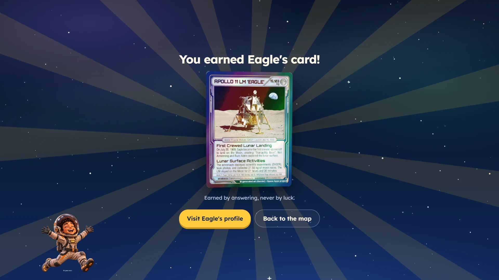<br><b>9. Earn its card</b>, never by luck</td>
    <td>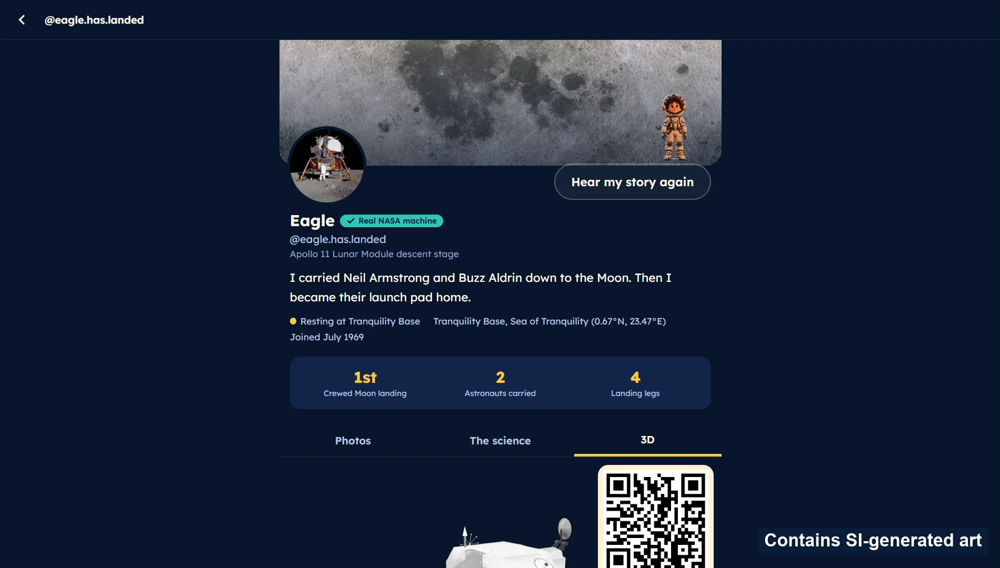<br><b>10. Profile</b> with NASA photos, facts, 3D and AR</td>
  </tr>
</table>

## What's inside

- **Your own astronaut.** Pick a boy or girl character, who appears in every scene.
- **A cinematic trip.** Rocket launch from Earth, a 3D solar system with the planets in their real order, then a landing on the chosen world.
- **Devices that talk.** Each device is a character that tells its story in short, voiced chunks. Phones get swipeable stories; laptops get a full scene.
- **Fact or Cap?** A quick true-or-false quiz after each story, with a hint and a retry on every wrong answer. No lock-outs.
- **Mini-games** for some devices: set up a moonquake station, land the Lunar Module, clean Opportunity's solar panels, find planets with Kepler.
- **Collectible cards** with a holo effect, kept in a card library.
- **Device profiles** in a social-media style: real NASA photos, stats and science facts, each with its source.
- **3D and AR.** Most devices have a NASA 3D model. On a phone, place it in your room with AR; on a laptop, scan a QR code to open it on your phone.

## The devices

14 NASA devices across 3 worlds. A level unlocks after the one before it; secret levels cost coins earned in quizzes.

| World | Levels | Secret level |
|---|---|---|
| 🌕 **The Moon** | Rumble (Apollo 12 ALSEP) 🎮 · Eagle (Apollo 11 Lunar Module) 🎮 · Falcon (Apollo 15 Lunar Module) | Surveyor 3 |
| 🔴 **Mars** | Pathfinder & Sojourner · Spirit · Opportunity 🎮 · InSight · Ingenuity | Viking 1 |
| ✨ **Deep space** | Pioneer 10 · NEAR Shoemaker · Dawn | Kepler 🎮 |

🎮 = has a mini-game

<p align="center">
  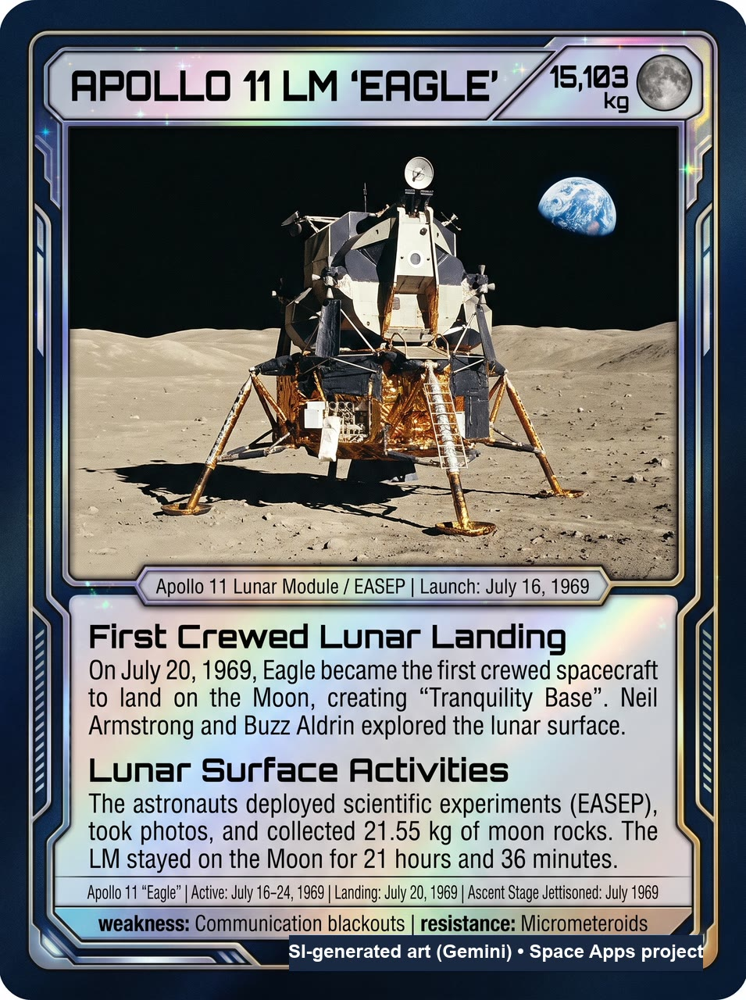
  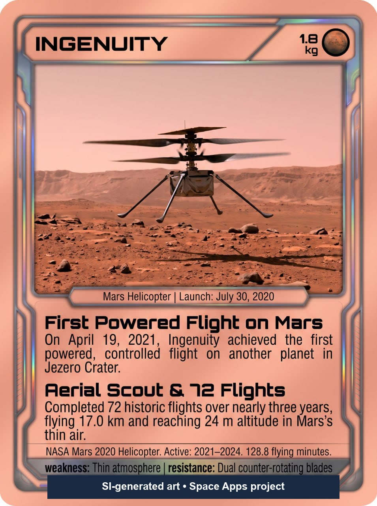
  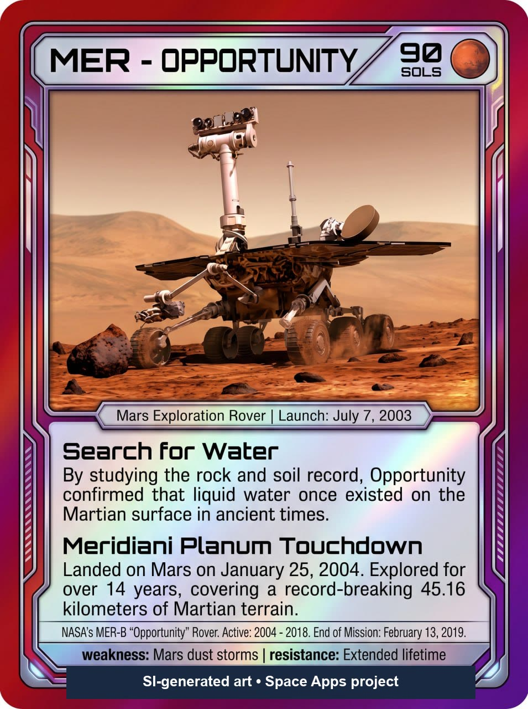
  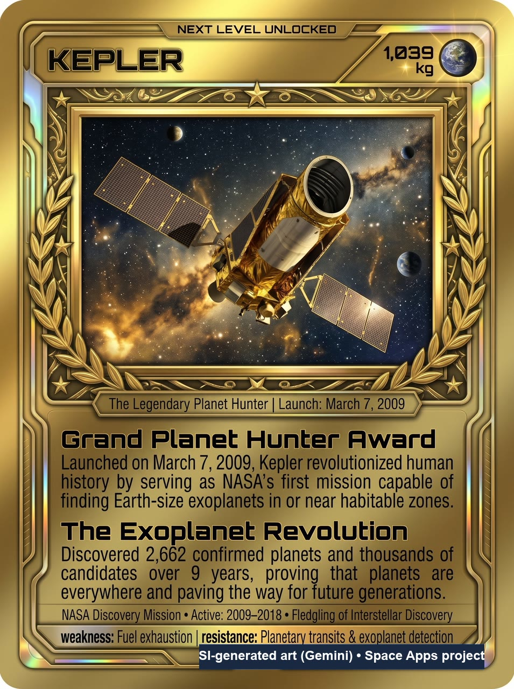
</p>

## Made for kids

- **Real facts only.** Every fact in the app links to NSSDCA or an official NASA page ([`docs/SOURCES.md`](docs/SOURCES.md)).
- **No dark patterns.** No streaks, no random rewards, no endless feed, no ads, no accounts, no personal data. Progress stays on the device.
- **A natural ending.** The mission ends and sends the kid outside: *look up at the real Moon tonight.*
- **Accessible.** Large tap targets, readable contrast, the Lexend font (made for young readers), and reduced motion when the device asks for it.

## Run it locally

You need [Node.js](https://nodejs.org) 20.19 or newer.

```bash
git clone https://github.com/Moaz-Sakrr/AstroTales.git
cd AstroTales
npm install
npm run dev
```

| Command | What it does |
|---|---|
| `npm run dev` | Start the dev server with hot reload |
| `npm run build` | Type-check and build to `dist/` |
| `npm run preview` | Serve the built site |
| `npm run lint` | Lint with oxlint |

**Testing shortcuts** (dev server only):

- `?play=<deviceId>` opens a mini-game directly, e.g. `?play=eagle`. Handy on a phone, where there is no console.
- `__game.setState({ screen: 'space' })` in the browser console jumps to any screen.
- `?ar=<deviceId>` opens a device's 3D/AR view. This one also works on the live site.

## How it's built

A static single-page app with no backend and no runtime network calls besides its own assets.

- **React 19 + TypeScript + Vite**, styled with **Tailwind CSS v4**
- **GSAP** for the launch, landing and story animations
- **three.js** for the solar system, **`<model-viewer>`** for 3D and AR
- **Zustand** for game state, saved to `localStorage`
- **Howler.js** for voices and NASA sounds; background music is generated live with the Web Audio API

```text
src/
  content/     story text, facts, quizzes, worlds, devices (edit content here, not in components)
  screens/     one file per screen: Launch, Space, LevelMap, Story, Quiz, CardReward, Library…
  components/  shared UI and art (Astronaut, Rocket, DeviceModel, Postcard…)
  space/       the three.js solar system
  audio/       sound effects, voices and generated music
  store/       game progress (Zustand)
public/        images, voices, NASA sounds, 3D models, textures, intro video
docs/          project plan, sources, screenshots, sound and voice notes
```

## Contributing

Start with [`docs/PROJECT_PLAN.md`](docs/PROJECT_PLAN.md), the full spec. [`CLAUDE.md`](CLAUDE.md) has the short list of code rules.

- One branch per task (`feat/map`, `content/opportunity`), open a PR, check the Vercel preview, merge.
- `main` always works. Every push to `main` deploys to the live site.
- Run `npm run build` before you push.
- New facts need a source URL (NSSDCA or NASA). No source, no fact.

## Credits

- **Facts:** NASA and NSSDCA, listed in [`docs/SOURCES.md`](docs/SOURCES.md). No NASA endorsement is implied.
- **Photos:** NASA and NASA/JPL-Caltech via [images.nasa.gov](https://images.nasa.gov) (public domain). Each photo links to its source in the app.
- **3D models:** [NASA 3D Resources](https://science.nasa.gov/3d-resources/).
- **Sounds:** NASA [historical sounds](https://www.nasa.gov/historical-sounds/) and [sounds from beyond](https://www.nasa.gov/sounds-from-beyond/).
- **Planet textures:** [Solar System Scope](https://www.solarsystemscope.com/textures/) (CC BY 4.0), based on NASA imagery.
- **Voices:** generated with [ElevenLabs](https://elevenlabs.io).
- **Fonts:** Lexend, Baloo 2 and Gochi Hand from Google Fonts (SIL Open Font License).
- **Libraries:** React, Vite, Tailwind CSS, GSAP, three.js, `<model-viewer>`, Howler.js, Zustand, uqr.
- **SI disclosure:** the card art (Gemini) and the kid and device character art (ChatGPT, from the team's sketches and NASA photos) are SI-generated. Cards and kid poses carry an "SI-generated" label. SI also helped draft story lines and code. Facts are never SI-written: each one links to its NASA source.

## License

[Apache 2.0](LICENSE)
